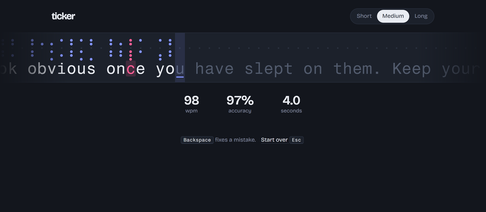
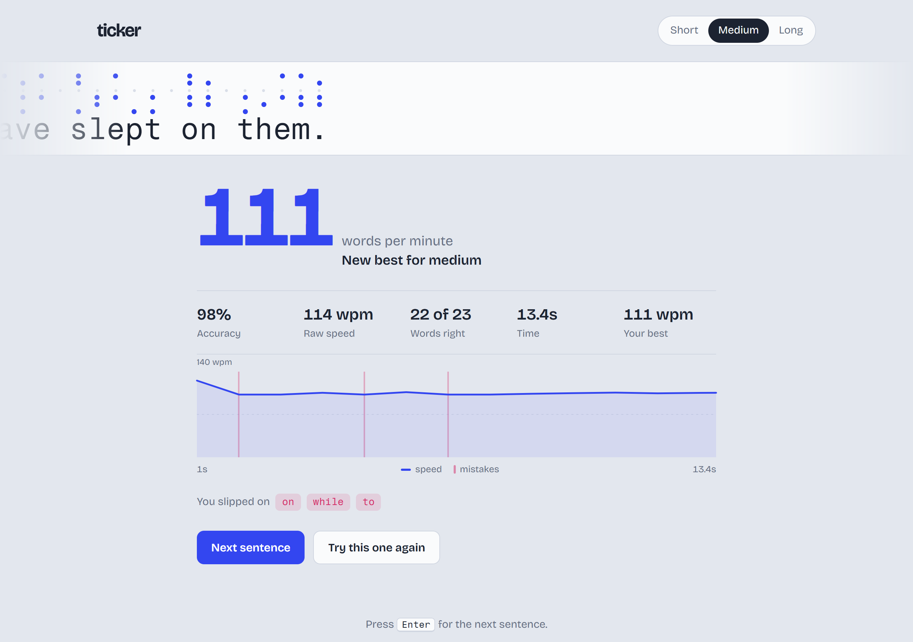
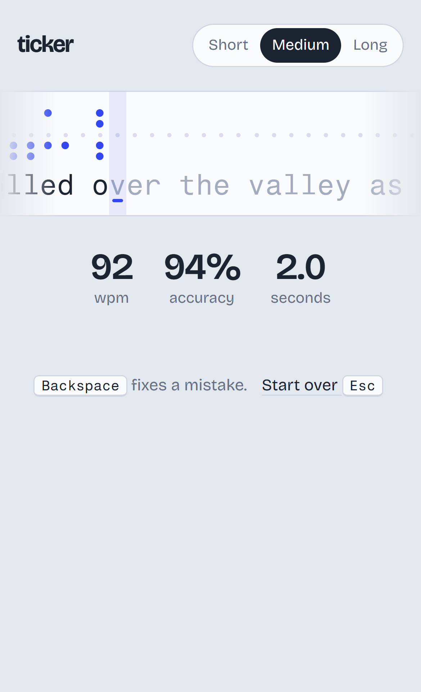

<div align="center">

# ticker

**A typing speed test on a strip of punched paper tape.**

Type the sentence. Every correct key punches its hole pattern into the tape. Every mistake punches a red rubout.




</div>

## What it does

- **Shows a real sentence** on a tape that slides under a fixed cursor, like a teleprinter.
- **Starts the clock on your first key** and shows live speed, accuracy and time while you type.
- **Grades every keystroke.** A mistake you fix still counts against your accuracy.
- **Ends with a results card:** final speed, raw speed, accuracy, words right, time, your best score, a speed-over-time chart with mistake markers, and the words you slipped on.
- **Three lengths:** Short (1 sentence), Medium (2) or Long (4), drawn from 30 sentences.
- **Works everywhere:** desktop keyboards, iPhone and Android on-screen keyboards, light and dark mode, reduced motion.

<p align="center">
  
  &nbsp;
  
</p>

## The tape

Each character gets a column of five hole positions, taken from the lower five bits of its character code. That's the same idea as the 5-hole Baudot tape that teleprinters used. A small sprocket hole runs down every column, so the tape has texture before you type anything.

| You type | The tape shows |
| --- | --- |
| The right key | Its hole pattern, punched in blue |
| The wrong key | All five holes punched in red (on paper tape, all holes meant "rubout") |
| Backspace | The holes close again |

## How it scores

| Measure | Formula |
| --- | --- |
| **Speed (wpm)** | characters currently correct ÷ 5 ÷ minutes |
| **Raw speed** | every character key pressed ÷ 5 ÷ minutes |
| **Accuracy** | keys right when pressed ÷ all keys pressed |
| **Words right** | words with every letter correct at the end |
| **Slipped on** | words where you made any mistake, even one you fixed |

"Five characters = one word" is the standard typing-test convention, spaces and punctuation included.

## Keys

| Key | Action |
| --- | --- |
| Any character | Type it |
| <kbd>Backspace</kbd> | Delete one character |
| <kbd>Ctrl</kbd> / <kbd>Alt</kbd> + <kbd>Backspace</kbd> | Delete the last word |
| <kbd>Esc</kbd> | New sentence (or start over) |
| <kbd>Enter</kbd> | Next sentence, from the results screen |

On a phone, tap the tape to open the keyboard.

## Why it feels smooth

- **Svelte 5 runes.** No virtual DOM. Each keystroke updates one character's class and nothing else.
- **One transform per keystroke.** The tape moves with `translate3d`, which the GPU handles without a layout pass. The character width is measured once with a `ResizeObserver` (it reruns when the web font loads or the screen resizes), not on every key.
- **The clock is decoupled from frames.** `requestAnimationFrame` only drives the on-screen timer. Speed samples are also taken on each keystroke, so the chart stays correct in a background tab or on a slow device.
- **Raw key events.** `keydown` on the window handles desktop keyboards. On phones, `beforeinput` handles keyboards that send key events, and `input` handles keyboards that send whole words as you type (Gboard and similar), so letters aren't typed twice.

## Run it

You'll need Node 20 or newer.

```bash
npm install
npm run dev        # http://localhost:5173
npm run build      # static site in dist/
npm run preview    # serve the built site
```

`dist/` is plain static files with relative paths, so you can host it anywhere.

### Deploy to GitHub Pages

[`.github/workflows/deploy.yml`](.github/workflows/deploy.yml) builds and publishes the site on every push to `main`. Turn it on once under **Settings → Pages → Source: GitHub Actions**.

## Project layout

```
src/
  App.svelte      the test: state, key handling, tape, results, chart
  sentences.js    the sentence list and the picker
  app.css         color tokens (light + dark), fonts, base styles
  main.js         mounts the app
docs/             README screenshots
```

To add your own sentences, edit the list in [`src/sentences.js`](src/sentences.js). Plain ASCII keeps everything typable on any keyboard.

## Privacy

Nothing leaves your browser. Your chosen length and best scores are kept in `localStorage`, and the page still works if storage is blocked.

## License

[MIT](LICENSE)
